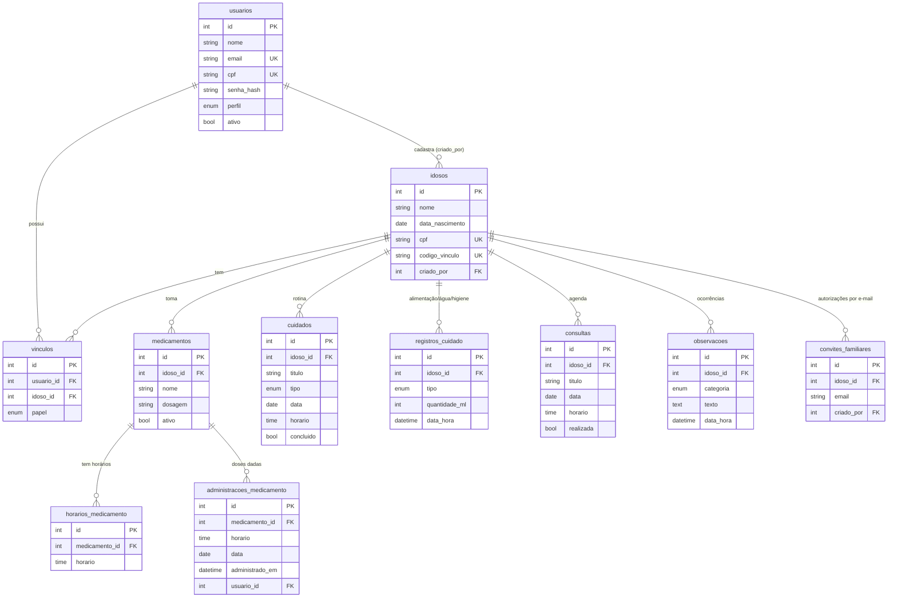

# Arquitetura do Cuidar+

## Camadas do backend

```
Requisição HTTP
   │
   ▼
 routes        mapeia URL -> controller e aplica middlewares (login, perfil, vínculo)
   ▼
 controllers   lê req, chama o service e devolve a resposta (sem regra de negócio)
   ▼
 services      regras de negócio e validação de dados
   ▼
 repositories  SQL parametrizado (único lugar que fala com o PostgreSQL)
   ▼
 PostgreSQL
```

Cada camada só conhece a de baixo. Trocar o banco, por exemplo, mexe apenas em `repositories/` e `config/`.

## Modelo de dados (DER)



## Decisões de projeto

| Decisão | Motivo |
|---|---|
| Tabela `vinculos` (N:N) | Um cuidador acompanha vários idosos e um idoso tem vários cuidadores/familiares |
| Código de vínculo (`CUIDAR-XXXXXX`) | Implementa a regra "familiar só acompanha se autorizado" sem depender de e-mail |
| `convites_familiares` | Permite autorizar um familiar pelo e-mail antes de ele ter conta; o convite vira vínculo no cadastro |
| Papel no vínculo (cuidador/familiar) | Familiar é somente leitura; a checagem é feita no servidor |
| Doses guardam o horário (não FK) | O histórico continua correto mesmo se os horários do medicamento mudarem |
| `ON DELETE CASCADE` nos registros do idoso | Excluir o idoso apaga tudo ligado a ele (direito de exclusão - LGPD) |
| Histórico por `UNION ALL` | Uma linha do tempo única, sem duplicar dados em outra tabela |
| Datas como texto (`dateStrings`/timestamp sem fuso) | Evita erros de fuso horário entre servidor, banco e navegador |
| Backend serve o frontend | Um comando (`npm start`) roda tudo; sem problemas de CORS |
